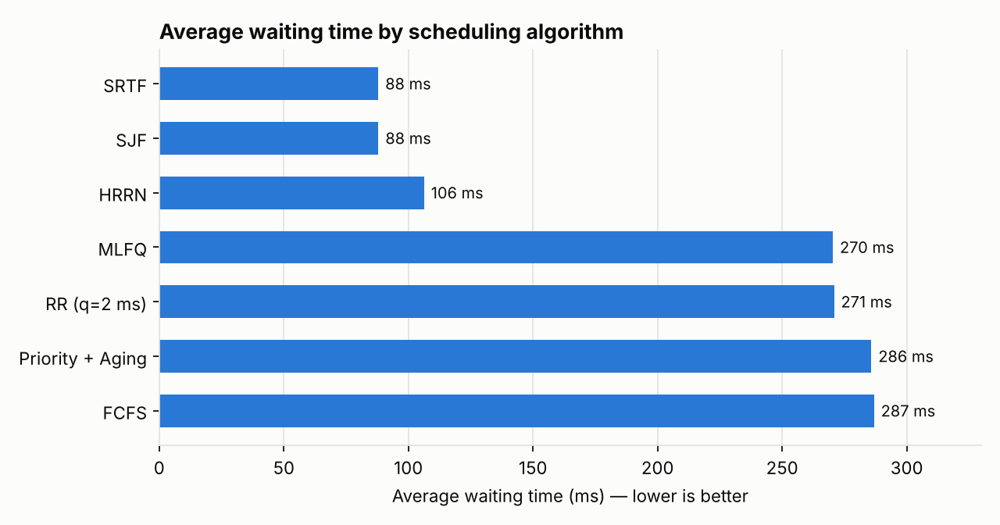
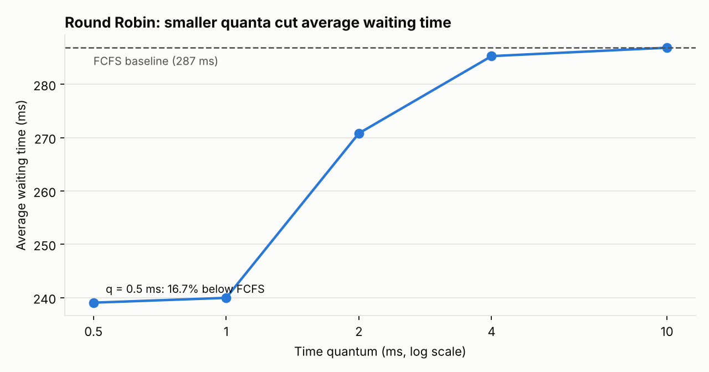

# CPU Scheduling & Process Control Simulator

A discrete-event simulator that models how an operating system schedules processes on a single CPU. It generates a synthetic workload of **1,000 processes**, runs it through **seven general-purpose schedulers** and **two real-time schedulers**, and compares them on waiting time, response time, turnaround time, CPU utilization, throughput, and deadline misses.


## Highlights

- **Event-driven simulation core** built on a binary-heap event queue: simulated time jumps from event to event (arrival, departure, quantum expiry) instead of ticking every millisecond
- **9 scheduling policies**: FCFS, SJF, SRTF, Round Robin, HRRN, Priority with Aging, Multilevel Feedback Queue, Rate-Monotonic, and Earliest-Deadline-First
- **Process control modeled explicitly**: dispatching, preemption with departure cancellation, demotion between queues, periodic priority boosting, and aging
- **Validated two ways**: a separate time-stepped (1 kHz) FIFO simulator produces exactly the same results as the event-driven FCFS scheduler, and 31 unit tests check hand-computed schedules and invariants
- **Key results**: SRTF cut average waiting time by **69%** vs. FCFS (287 ms → 88 ms), and Round Robin with a 0.5 ms quantum cut it by **16.7%**

## Results

All seven schedulers run on the same 1,000-process workload (Poisson arrivals at 2 processes/ms, exponential service times with a 1 ms mean, seed 3360).



| Metric | FCFS | SJF | SRTF | RR (q=2 ms) | HRRN | Priority + Aging | MLFQ |
| :--- | ---: | ---: | ---: | ---: | ---: | ---: | ---: |
| Avg waiting time (ms) | 286.86 | 88.00 | **87.95** | 270.81 | 106.32 | 285.80 | 270.35 |
| Avg response time (ms) | 286.86 | 88.00 | **87.95** | 243.99 | 106.32 | 285.80 | 243.08 |
| Avg turnaround time (ms) | 287.82 | 88.95 | **88.91** | 271.77 | 107.27 | 286.76 | 271.31 |
| Max waiting time (ms) | **539** | 901 | 901 | 840 | 887 | **539** | 847 |
| Avg ready queue length | 300.38 | 92.14 | **92.10** | 283.57 | 111.33 | 299.27 | 283.09 |

Every policy is work-conserving, so all of them finish the workload in 955 ms at 100% CPU utilization and 1,047 processes/s throughput. The differences are entirely in *who waits*.

**What the numbers show**

- **Shortest-job policies win on average, lose on fairness.** SJF and SRTF have the lowest average waiting time but the worst maximum wait (901 ms): long jobs get pushed back repeatedly.
- **HRRN is the compromise.** Its response ratio (W + S) / S grows as a job waits, so it keeps most of SJF's benefit (106 ms average) while aging long jobs forward.
- **Aging bounds the worst case.** Priority with Aging matches FCFS's 539 ms maximum wait, the lowest of any policy, so no process starves.
- **MLFQ favors short, interactive jobs.** It improves average response time to 243 ms by finishing short jobs in the high-priority queue, at the cost of a longer worst-case wait for CPU-bound jobs.

### Round Robin quantum sweep



| Quantum (ms) | Avg waiting (ms) | Reduction vs. FCFS |
| :--- | ---: | ---: |
| 0.5 | 239.06 | 16.7% |
| 1 | 239.96 | 16.4% |
| 2 | 270.81 | 5.6% |
| 4 | 285.29 | 0.5% |
| 10 | 286.86 | 0.0% |

Smaller quanta let short jobs finish sooner. Once the quantum exceeds nearly every service time, Round Robin degenerates into FCFS. The simulation does not charge for context switches, so in a real OS the smallest quantum would not be free.

### Real-time scheduling

Three periodic tasks with implicit deadlines over a 12 ms hyper-period:

| Task | Period (ms) | Execution (ms) |
| :--- | ---: | ---: |
| T1 | 4 | 1 |
| T2 | 6 | 2 |
| T3 | 12 | 3 |

Total utilization is U = 1/4 + 2/6 + 3/12 = **83.3%**. That is above the Liu & Layland sufficient bound for Rate-Monotonic with three tasks (3(2^(1/3) − 1) ≈ 77.98%) but below EDF's 100% bound.

| Policy | Timeline (1 ms slots) | Deadline misses |
| :--- | :--- | ---: |
| Rate-Monotonic | T1 T2 T2 T3 T1 T3 T2 T2 T1 T3 Idle Idle | 0 |
| Earliest-Deadline-First | T1 T2 T2 T3 T1 T3 T3 T2 T2 T1 Idle Idle | 0 |

Both meet every deadline. The RM bound is sufficient but not necessary, so a task set above it can still be schedulable.

Full output: [`results/RESULTS.md`](results/RESULTS.md).

## Algorithms

| Algorithm | Preemptive | Selection rule | Strength | Weakness |
| :--- | :---: | :--- | :--- | :--- |
| **FCFS** | No | Earliest arrival | Simple, fair in order | Convoy effect behind long jobs |
| **SJF** | No | Shortest service time | Low average waiting time | Long jobs can starve |
| **SRTF** | Yes | Shortest remaining time | Optimal average waiting time | Frequent preemption, starvation |
| **Round Robin** | Yes | FIFO with a time quantum | Good response time | Sensitive to quantum size |
| **HRRN** | No | Highest (W + S) / S | Balances short jobs with aging | Needs service-time estimates |
| **Priority + Aging** | No | Best effective priority; +1 level per 10 ms waited | Prevents starvation | Priorities must be assigned |
| **MLFQ** | Yes | Q0: RR (2 ms) → Q1: FCFS, boost every 20 ms | Adapts to job behavior | More parameters to tune |
| **Rate-Monotonic** | Yes | Shortest period (static) | Predictable, simple | Utilization bound below 100% |
| **EDF** | Yes | Earliest deadline (dynamic) | Schedules up to 100% utilization | Unpredictable under overload |

## How the simulator works


- **Workload**: inter-arrival times and service times are sampled by inverse transform from exponential distributions (`-ln(U) / λ`), rounded to whole milliseconds. Priorities 1 to 10 come from a separate random stream so they never change the arrival pattern.
- **Event queue**: a min-heap keyed on `(time, event-type rank, PID)`. Each scheduler sets how simultaneous events are ordered; for example, Round Robin queues new arrivals ahead of a preempted process.
- **Preemption**: SRTF cancels the running process's pending departure event and returns it to the ready queue when a strictly shorter job appears.
- **Tick-based schedulers**: MLFQ and the real-time schedulers advance in 1 ms ticks, since quantum accounting and periodic releases are naturally per-tick.

## Getting started

```bash
git clone https://github.com/sumit-sah314/cpu-scheduling-simulator.git
cd cpu-scheduling-simulator
pip install -r requirements.txt

python run_benchmarks.py                       # full comparison, writes results/
python run_benchmarks.py --processes 5000 --seed 42
python -m pytest                               # run the test suite
```

Use the package directly:

```python
from scheduler import generate_workload, srtf, round_robin, compute_metrics

workload = generate_workload(num_processes=1000, seed=3360)
jobs, timeline = srtf(workload)
print(compute_metrics(jobs)["avg_waiting_ms"])          # 87.951

jobs, _ = round_robin(workload, quantum=0.5)
print(compute_metrics(jobs)["avg_waiting_ms"])          # 239.056
```

## Project structure

```
cpu-scheduling-simulator/
├── scheduler/
│   ├── process.py      # Process model and event types
│   ├── events.py       # Heap-based event queue
│   ├── workload.py     # Poisson / exponential workload generator
│   ├── classic.py      # FCFS, SJF, SRTF, Round Robin, HRRN
│   ├── advanced.py     # Priority with Aging, Multilevel Feedback Queue
│   ├── realtime.py     # Rate-Monotonic, Earliest-Deadline-First
│   ├── fifo_tick.py    # Time-stepped FIFO baseline with CPU trace
│   └── metrics.py      # Waiting, response, turnaround, utilization, throughput
├── tests/
│   └── test_schedulers.py
├── results/            # Generated report and charts
├── run_benchmarks.py
└── requirements.txt
```

## Concepts covered

Process scheduling, preemptive vs. non-preemptive policies, starvation and aging, multilevel feedback queues, real-time schedulability (Liu & Layland), discrete-event simulation, priority queues, Little's law, and performance benchmarking.

Originally developed for CS 3360 (Computing Systems Fundamentals) at Texas State University, then refactored into a tested Python package.

## Author

**Sumit Sah**: B.S. Computer Science & Applied Mathematics, Texas State University
[GitHub](https://github.com/sumit-sah314) · [LinkedIn](https://linkedin.com/in/sumit-sah-4a487622b) · [Portfolio](https://sumit-sah314.github.io/my-portfolio-website/)

## License

MIT. See [LICENSE](LICENSE).
