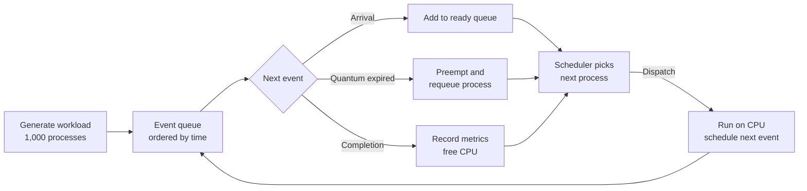

# CPU Scheduling & Process Control Simulator

An event-driven, discrete-event simulator that models how an operating system schedules processes on a CPU. It runs a workload of **1,000 processes** through five classic scheduling algorithms and compares them on the metrics an OS designer cares about: CPU utilization, throughput, response time, and waiting time.


## Highlights

- **Five scheduling algorithms**: FCFS, SJF, SRTF, Round Robin, and HRRN, including both non-preemptive and preemptive policies
- **Discrete-event simulation core** driven by a priority-ordered event queue, so simulated time jumps from event to event instead of ticking
- **Process control modeled explicitly**: arrival, dispatch, preemption, and completion, with a ready queue and process state transitions
- **Benchmarking across four metrics** on an identical workload, so algorithms are compared fairly
- **Headline result:** Round Robin with a 0.5 ms time quantum reduced average waiting time by **16.7%** compared to FCFS on the same 1,000-process workload

## Algorithms

| Algorithm | Preemptive | Selection rule | Strength | Weakness |
|---|---|---|---|---|
| **FCFS** (First-Come, First-Served) | No | Earliest arrival | Simple, no starvation | Convoy effect behind long jobs |
| **SJF** (Shortest Job First) | No | Shortest burst time | Minimizes average waiting time among non-preemptive policies | Long jobs can starve |
| **SRTF** (Shortest Remaining Time First) | Yes | Shortest remaining burst | Optimal average waiting time | Frequent preemption; starvation risk |
| **Round Robin** | Yes | Rotating time quantum | Fair, good response time | Performance depends on quantum size |
| **HRRN** (Highest Response Ratio Next) | No | Highest (wait + burst) / burst | Balances short jobs with aging | Requires burst estimates |

## How the simulator works

The simulator is built around a discrete-event loop. Instead of advancing time in fixed ticks, it pulls the next event (ordered by timestamp) from a priority queue, updates the system state, and schedules any follow-up events.



**Event types**

- **Arrival**: a process enters the system and joins the ready queue
- **Dispatch**: the scheduler selects a process from the ready queue and assigns it the CPU
- **Preemption**: a running process is interrupted (time quantum expiry in Round Robin, or a shorter job arriving in SRTF) and returned to the ready queue
- **Completion**: a process finishes its CPU burst and leaves the system

Each algorithm plugs in as a different policy for choosing from the ready queue, while the event loop, process model, and metric collection stay the same.

## Metrics

| Metric | Definition |
|---|---|
| **CPU utilization** | Fraction of simulated time the CPU is busy |
| **Throughput** | Processes completed per unit of time |
| **Response time** | Time from arrival until a process first gets the CPU |
| **Waiting time** | Total time a process spends in the ready queue |

## Results

All algorithms were run on the same 1,000-process workload.

- Round Robin (0.5 ms quantum) reduced **average waiting time by 16.7%** compared to FCFS.

<!-- TODO: add the full benchmark table (utilization, throughput, response time, waiting time per algorithm) and any plots -->

## Getting started

```bash
git clone https://github.com/sumit-sah314/cpu-scheduling-simulator.git
cd cpu-scheduling-simulator
```

<!-- TODO: add install steps and the command to run the simulator, e.g. python main.py -->

## Project structure

<!-- TODO: update to match the actual files once the code is pushed -->

```
cpu-scheduling-simulator/
├── README.md
├── LICENSE
└── .gitignore
```

## Concepts covered

Operating systems process scheduling, preemptive vs. non-preemptive scheduling, discrete-event simulation, priority queues, process state transitions, and performance benchmarking.

## Author

**Sumit Sah** · B.S. Computer Science & Applied Mathematics, Texas State University
[GitHub](https://github.com/sumit-sah314) · [LinkedIn](https://linkedin.com/in/sumit-sah-4a487622b) · [Portfolio](https://sumit-sah314.github.io/my-portfolio-website/)

## License

This project is licensed under the MIT License. See [LICENSE](LICENSE) for details.
